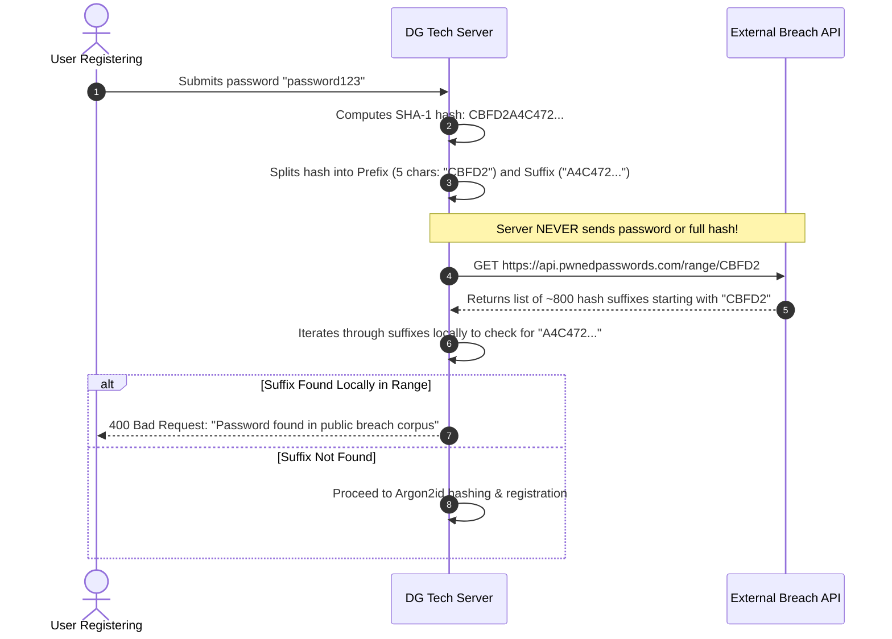

# Breached Password Verification via k-Anonymity (`docs/breach-check.md`)

**Workstream**: `task-04-server-security/`  
**Domain**: DG Tech Store (Shop ATF 03)  
**Standard**: Step 9 (Preventing Leaked Password Reuse Without Leaking Passwords)  

---

## 1. The Threat: Credential Reuse & Compromised Passwords

Over 80% of successful account takeovers originate from **credential stuffing**: attackers take usernames and passwords leaked from breaches of other websites and try them against every platform they encounter.

When customers register at DG Tech Store, many instinctively reuse weak or previously compromised passwords (e.g., `password123`, `P@ssword1`). Enforcing a breached password check at registration stops this vulnerability before the account is ever created.

---

## 2. The Naive Implementation & Why It is Unacceptable

A novice developer tasked with verifying whether a password has been breached builds the naive approach:
```ts
// DANGEROUS / UNACCEPTABLE NAIVE PATTERN:
async function naiveCheck(password: string) {
  return await fetch("https://api.breach-service.com/check", {
    method: "POST",
    body: JSON.stringify({ password }), // Transmits cleartext password over the wire!
  });
}
```

### Why the Naive Version is a Critical Security Failure:
1. **Third-Party Plaintext Disclosure**: The business transmits the user's unhashed password to an external third-party service. If that external service is intercepted, logged, or compromised, the developer has personally leaked their own customer's credentials in the act of trying to protect them.
2. **Sending the Full Hash Fails Too**: Sending the full SHA-1 or MD5 hash (`crypto.createHash('sha1').update(password).digest('hex')`) is equally broken: because the third-party service maintains the reverse lookup table of billions of hashes, possessing the full hash is computationally equivalent to possessing the password itself.

---

## 3. The k-Anonymity Mechanism (How It Works in Our Implementation)

Our implementation (`lib/security/breach-checker.ts`) implements the industry-standard **k-Anonymity range query protocol** (pioneered by HaveIBeenPwned and Cloudflare):



### Step-by-Step Mathematical Explanation:
1. **Local Digest Generation**: The server calculates the SHA-1 hash of the user's password locally.
   - Example: Password `password123` produces SHA-1 `CBFD2A4C4721346D0F9A6E4A79E405E5276979A5`.
2. **5-Character Prefix Truncation**: The server extracts only the first 5 hexadecimal characters: `CBFD2`.
   - The remaining 35 characters (`A4C4721346D0F9A6E4A79E405E5276979A5`) are retained strictly in server memory.
3. **The Range Query**: The server requests `GET https://api.pwnedpasswords.com/range/CBFD2`.
   - The external API receives **only 5 characters**.
   - Because $16^5 = 1,048,576$ buckets exist across billions of compromised passwords, thousands of completely unrelated passwords share the exact same prefix `CBFD2`. The external service cannot discern which password the user typed.
4. **Local Suffix Matching**: The external service responds with a plaintext list of all hash suffixes matching that prefix, along with breach frequencies:
   ```text
   0018F...:1
   00D12...:4
   A4C4721346D0F9A6E4A79E405E5276979A5:184520  <-- Exact local match!
   FFF89...:2
   ```
5. **Local Decision**: The server performs the comparison locally. If the suffix matches, the password is confirmed breached and rejected.

**Security Guarantee**: The cleartext password never leaves our server boundary, the full hash is never disclosed, and the user is protected from known breached credentials.
