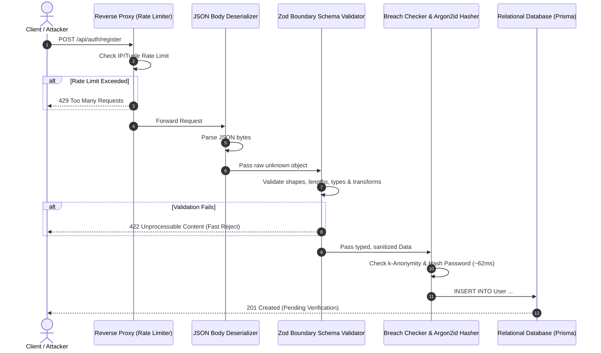

# Server-Side Boundary Validation & Request Lifecycle Placement (`docs/validation-placement.md`)

**Workstream**: `task-04-server-security/`  
**Domain**: DG Tech Store (Shop ATF 03)  
**Standard**: Step 6 (Schema Validation at the Boundary)  

---

## 1. Where in the Request Lifecycle Validation Sits

In a secure backend architecture, schema validation sits directly at the **outer boundary of the application layer**, immediately after HTTP protocol deserialization (JSON parsing) and before any business logic, database queries, authentication checks, or downstream service invocations.

---

## 2. What Runs Before Validation

Only operations strictly required to ingest and meter the HTTP packet may run prior to schema validation:
1. **Network Transport Security (TLS Termination)**: Validates TLS certificates and decrypts the encrypted transport layer.
2. **Reverse Proxy Edge Filtering (DDoS Mitigation)**: Web Application Firewall (WAF) checks for volumetric floods, HTTP protocol compliance, and header size boundaries.
3. **Rate Limiting Checks**: IP and connection rate limiters must run before validation to reject denial-of-service spam before CPU cycles are spent parsing JSON.
4. **Content-Type & Body Deserialization**: The runtime ensures `Content-Type: application/json` is present and deserializes raw bytes into memory up to a hard request size limit (e.g., 1 MB maximum to prevent memory exhaustion).

---

## 3. What Must NEVER Run Before Validation

Executing business operations or sensitive operations before boundary validation is an architectural security vulnerability:

1. **Database Queries**: Never query the database (e.g., `findUnique`, `SELECT`) using raw, unvalidated input. Doing so exposes the system to injection, malformed SQL parameters, and connection pool exhaustion.
2. **Expensive Cryptographic Hashing**: As proven in Step 4, Argon2id requires ~62 ms of dedicated CPU time per invocation. If hashing runs before validation, an attacker sending 1,000 requests with junk emails and single-character names (`"fullName": "a"`) will peg server CPU at 100%, causing a total Denial of Service.
3. **External Network API Calls**: Sending SMS messages, querying external credit bureaus, or contacting email delivery gateways prior to shape validation wastes money and opens outbound connection starvation.
4. **Session Creation or State Mutation**: No tokens, database rows, or cache keys may be generated until the input payload has been proven structurally sound.

---

## 4. Why Hand-Written Route Validation is Inferior to Schema Libraries

Developers often argue that writing manual `if (!body.email || !body.email.includes('@'))` checks in the route handler is simpler and avoids installing libraries like Zod. This assumption is dangerously flawed:

1. **Lack of Type Narrowing & Dual Maintenance**:
   - Hand-written `if` checks do not narrow TypeScript types. The developer must manually maintain both a TypeScript `interface RegisterRequest` and 20 lines of procedural conditionals. Inevitably, the interface and the runtime checks drift out of sync.
   - Zod derives the compile-time type directly from the runtime schema (`type ServerRegisterInput = z.infer<typeof serverRegisterSchema>`), ensuring mathematical synchronization between static types and runtime validation.
2. **Incomplete Coverage & Edge-Case Leaks**:
   - Hand-written validation consistently misses edge cases: `null` vs `undefined`, prototype pollution (`__proto__`), array inputs where strings were expected (`{"email": ["a", "b"]}` causing `.toLowerCase()` runtime crashes), and unexpected extra fields.
   - Zod strictly strips unparsed properties (`strip`), rejects invalid primitives, and validates deeply nested objects deterministically.
3. **Inconsistent Error Formats**:
   - Procedural route handlers return idiosyncratic error messages and varying HTTP status codes. Zod produces structured, machine-readable issue arrays (`{ field, message, code }`) that client applications and VoiceOver screen readers can parse reliably.
